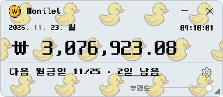

# Monilet

작은 반려 펫과 함께, 일하는 동안 쌓이는 금액을 데스크톱 위젯으로 확인하세요.

**[Windows용 다운로드](https://github.com/iffert23/Monilet/releases/latest)** · [업데이트 내역](https://github.com/iffert23/Monilet/releases) · [오류·기능 제안](https://github.com/iffert23/Monilet/issues/new/choose)

**Windows 정식 1.1.13** · **[macOS 1.1.12 사전배포](https://github.com/iffert23/Monilet/releases/tag/macos-v1.1.12)** · Android 개발 중

macOS는 macOS 13 이상, Apple Silicon·Intel Mac을 지원합니다. 사전배포 페이지에서 DMG 또는 ZIP과 첫 실행 안내를 확인하세요. 플랫폼별 설치 방법은 [공식 사이트](https://monilet.hachjy.com/)에서도 볼 수 있습니다.

## 다운로드하고 시작하기

1. 위 다운로드 링크에서 **Monilet-Setup-버전.exe** 설치 파일 하나를 받으세요. GitHub 로그인은 필요하지 않습니다.
2. 파일을 열고 **설치**, 완료되면 **실행**을 누르세요. 별도로 압축을 풀 필요가 없습니다.
3. 앱 설정에서 **근무시간·월급일·급여**를 입력하고 저장하세요. 위젯은 바탕화면에서 누적 금액을 보여줍니다.

Windows 10(1903 이상) 또는 Windows 11의 64비트 PC에서 사용할 수 있습니다. 설치 후에는 인터넷 없이 동작합니다.

설치 위치는 `%LOCALAPPDATA%\Programs\Monilet`입니다. 기존 버전을 업데이트하면 새 경로로 옮겨지고 이전 프로그램 파일과 바로가기는 정리됩니다. 저장된 기록은 유지됩니다.

## 내 방식대로 사용하기

- 세후 연봉 직접 입력, 세전 연봉 자동 공제, 세전 금액 그대로 사용을 선택할 수 있습니다.
- 요일별 근무시간과 날짜별 유급·무급휴가, 야근·잔업을 설정할 수 있습니다.
- 내장 테마와 파스텔 배경색, 위젯 크기·투명도·모니터 위치를 고를 수 있습니다.
- **사용자 지정**에서 투명 배경의 **512×512px PNG, 2MB 이하** 이미지를 선택할 수 있습니다. 조건이 맞지 않으면 선택할 수 없습니다.
- **‘−’**로 금액과 시계를 전환하며 테마는 유지합니다. **‘×’**로 위젯을 트레이로 숨깁니다. 트레이 메뉴에서 다시 표시하거나 완전히 종료할 수 있습니다.

## 작은 반려 펫과 함께하기

설정의 **반려 펫** 메뉴에서 켤 수 있습니다. 무료 반려 펫은 **날개돈다발·날개코인**이며, 유료 서비스 예정인 동물 반려 펫 10종은 설정창에서 움직임과 소개를 미리 볼 수 있습니다. 구매는 추후 제공될 예정입니다.

반려 펫마다 이름을 짓고 출근·퇴근·월급날·월급날 전날의 대사와 표시 시간대를 고르세요. 직접 정한 응원 문구도 사용할 수 있습니다. 반려 펫은 기본으로 꺼져 있으며 기본 급여 계산 기능은 계속 무료로 사용할 수 있습니다.

## 업데이트

앱의 **정보 → 업데이트 확인 → 업데이트**를 이용하세요. 구버전의 설치 버튼은 ‘다운로드 후 설치’로 표시될 수 있습니다. 새 설치는 **자동 업데이트**가 기본으로 켜져 있습니다. 끄고 저장한 선택은 다음 업데이트에도 유지합니다. **새 버전 자동 확인**을 끄면 자동 업데이트·알림도 함께 해제되고 비활성화됩니다. 기존 설정과 기록은 유지합니다.

## 다른 PC로 기록 옮기기

사용하던 PC의 **정보 → 데이터 내보내기**에서 파일을 저장하세요. 새 PC에 Monilet을 설치한 뒤 **정보 → 데이터 가져오기**로 파일을 선택하면 됩니다. 가져오기 전의 데이터는 자동 백업합니다.

급여·근무 기록과 사용자 이미지는 사용 중인 PC에 저장되며 데이터 백업에도 포함됩니다. 앱 계정은 필요하지 않습니다. 백업 파일에는 개인 정보가 담기므로 직접 보관해 주세요.

정보 메뉴 맨 아래의 **설명서** 버튼으로 [사용 안내](https://monilet.hachjy.com/)를 열 수 있습니다.

## 도움이 필요할 때

### 설치 중 SmartScreen 안내가 표시되나요?

‘Windows의 PC 보호’ 화면만으로 바이러스가 발견됐다는 뜻은 아닙니다. SmartScreen은 앱의 게시자와 평판을 확인하는 Windows 기능이며, Monilet은 현재 코드 서명이 없어 안내가 표시될 수 있습니다.

이 저장소의 공식 다운로드에서 받은 파일인지 확인해 주세요. SmartScreen 안내와 백신의 실제 악성코드 탐지는 구분해야 합니다. 백신이 탐지를 알리거나 회사 보안 정책으로 차단한 경우에는 실행을 멈추고 담당자에게 확인해 주세요.

문제가 계속되면 [오류 신고](https://github.com/iffert23/Monilet/issues/new/choose)에 화면과 오류 메시지를 남겨 주세요. 이슈 작성에는 GitHub 로그인이 필요합니다. 앱의 **진단 자료 내보내기**를 이용할 수 있으며, 급여가 담긴 백업 파일은 공개 이슈에 첨부하지 마세요.

이 저장소는 설치 파일 배포·업데이트 정보·이슈 접수용입니다.
