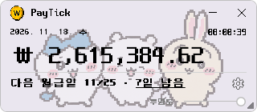

# PayTick

일하는 동안 쌓이는 금액을 작은 Windows 위젯으로 확인하세요.

**[Windows용 다운로드](https://github.com/iffert23/Pay-Tick/releases/latest)** · [업데이트 내역](https://github.com/iffert23/Pay-Tick/releases) · [오류·기능 제안](https://github.com/iffert23/Pay-Tick/issues/new/choose)

## 다운로드하고 시작하기

1. 위 다운로드 링크에서 **PayTick-Setup-버전.exe** 설치 파일 하나를 받으세요. GitHub 로그인은 필요하지 않습니다.
2. 파일을 열고 **설치**, 완료되면 **실행**을 누르세요. 별도로 압축을 풀 필요가 없습니다.
3. 앱 설정에서 **근무시간·월급일·급여**를 입력하고 저장하세요. 위젯은 바탕화면에서 누적 금액을 보여줍니다.

Windows 10(1903 이상) 또는 Windows 11의 64비트 PC에서 사용할 수 있습니다. 설치 후에는 인터넷 없이 동작합니다.

## 내 방식대로 사용하기

- 세후 연봉 직접 입력, 세전 연봉 자동 공제, 세전 금액 그대로 사용을 선택할 수 있습니다.
- 요일별 근무시간과 날짜별 유급·무급휴가, 야근·잔업을 설정할 수 있습니다.
- 내장 테마와 파스텔 배경색, 위젯 크기·투명도·모니터 위치를 고를 수 있습니다.
- 위젯을 닫으면 트레이로 숨깁니다. 트레이 메뉴에서 다시 표시하거나 완전히 종료할 수 있습니다.

## 업데이트

앱의 **정보 → 업데이트 확인 → 업데이트**를 이용하세요. 구버전의 설치 버튼은 ‘다운로드 후 설치’로 표시될 수 있습니다. 자동 확인·알림도 선택할 수 있으며, 기존 설정과 기록은 유지합니다.

## 다른 PC로 기록 옮기기

사용하던 PC의 **정보 → 데이터 내보내기**에서 파일을 저장하세요. 새 PC에 PayTick을 설치한 뒤 **정보 → 데이터 가져오기**로 파일을 선택하면 됩니다. 가져오기 전의 데이터는 자동 백업합니다.

급여와 근무 기록은 사용 중인 PC에 저장됩니다. 앱 계정은 필요하지 않습니다. 백업 파일에는 개인 정보가 담기므로 직접 보관해 주세요.

## 도움이 필요할 때

현재 설치 파일에는 코드 서명이 없어 Chrome 또는 Windows에서 경고가 표시될 수 있습니다. 회사 PC라면 사내 보안 정책을 확인해 주세요.

문제가 계속되면 [오류 신고](https://github.com/iffert23/Pay-Tick/issues/new/choose)에 화면과 오류 메시지를 남겨 주세요. 이슈 작성에는 GitHub 로그인이 필요합니다. 앱의 **진단 자료 내보내기**를 이용할 수 있으며, 급여가 담긴 백업 파일은 공개 이슈에 첨부하지 마세요.

이 저장소는 설치 파일 배포·업데이트 정보·이슈 접수용입니다.
